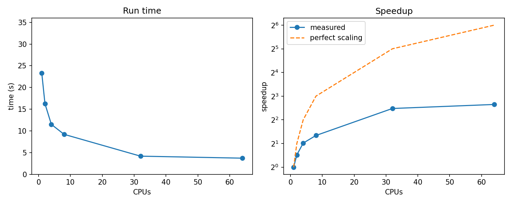

:::::::::::::::::::::::::::::::::::::: questions

- Once I know where the time goes, what can I do about it?
- Which changes give the most for the least effort?
- How do I check that a faster program still gives the right answer?

::::::::::::::::::::::::::::::::::::::::::::::::

::::::::::::::::::::::::::::::::::::: objectives

- Try a library routine and a newer software stack as ways to make a program faster.
- Measure the effect of each change on the run time and in the profile.
- Check that the results still agree after a change.

::::::::::::::::::::::::::::::::::::::::::::::::

The profile in the last episode showed where our script spends its time. Before changing the algorithm, it is worth trying the
cheapest options first, and measuring each one. The rule is: **change one thing at a time, and measure.**

## Option 1: don't reinvent the wheel

Our loop computes the average distance between pairs of rows by hand. This is a very common calculation, and SciPy has a
routine for it, `scipy.spatial.distance.pdist`, written in compiled code:

```python
from scipy.spatial.distance import pdist

def mean_pair_distance(X, m=800):
    return pdist(X[:m]).mean()
```

It gives the same answer as the loop, for the same pairs. Copy `sweep.py` to `sweep-pdist.py`, replace the function, and run
it with the same job script and the same number of CPUs as before.

The result is not as good as we hoped for since the change does not make the run much faster. However, that is a good
 lesson in itself. A library routine is still a good idea, because it is often faster to run, faster to write and better
tested.

## Option 2: a newer software stack

Our job loads `SciPy-bundle/2023.07-gfbf-2023a`. Falcon also has a newer one, `SciPy-bundle/2025.07-gfbf-2025b`, with newer
versions of Python, numpy, SciPy and the maths libraries behind them. Nothing in our code changes, only the module line, and we
keep the habit from earlier of purging first and loading a consistent set:

```bash
module purge
module load SciPy-bundle/2025.07-gfbf-2025b
```

Run the same script, with the same CPUs. On 8 CPUs the run time falls from about 20 seconds to about 13 seconds, with no change to our code.

Why? Newer versions of numpy and of the linear algebra libraries bring faster code and better support for the newest processors.
<!--
We have not yet isolated which change matters here. You can start by looking at what each stack provides:

```bash
python --version
python -c "import numpy; print(numpy.__version__)"
OPENBLAS_VERBOSE=2 python -c "import numpy"
```

The last command makes the OpenBLAS library print the CPU kernel it chose. If the two stacks choose different ones for the same
node, that is a clue, and it is the same question as the differences between processor architectures that we will meet again in the
GPU and architecture episodes.
-->

:::::::::::::::::::::::::::::::::::::: challenge

## Challenge: three variants, one table

Run the same job, with 8 CPUs, for each variant, three times each, and fill in the
average run time (the last column of the result file).

| Variant | Time (s) | Faster than the original? |
|---|---:|---|
| Original (`2023.07`, loop) | | |
| `pdist` (`2023.07`) | | |
| Original loop (`2025.07`) | | |
| `pdist` (`2025.07`) | | |

1. Which change helped most? Which helped least?
2. Open the profile for the original loop on each stack (use `map` as in the last episode). What changed in the profile?
3. Which would you apply first on your own code, and why?

::::::::::::::::::::::::::::::::::::: solution

1. In our runs the newer stack helped most, from about 20 s to about 13 s, and `pdist` gave little (but still a couple of seconds).
2. Look at the profile of each, and compare the hotspot lines and their shares. Say what you see rather than what you expect.
3. Changing the software stack costs nothing and keeps the code as it is, so it is the first thing to try. 
4. Replacing code with a library routine is good practice, but the profile tells you whether it is worth doing. This is the
   fastest version.

:::::::::::::::::::::::::::::::::::::

::::::::::::::::::::::::::::::::::::::::::::::::

## Check that the answer has not changed

A faster program that gives a different answer is not an improvement. Compare the results of the two runs for the same seed:

```bash
cut -d, -f2,3 result_42_old.csv result_42_new.csv
```

```output
0.0048,109.5014
0.0048,109.5014
```

The columns are the explained variance and the mean distance. Differences in the last few digits are normal (depending
on your precision), because different libraries and compilers add up numbers in different orders. A difference in the
first digits is not, and means something has changed which you need to understand.

:::::::::::::::::::::::::::::::::::::: callout

## Notes on changing the software stack

- **Newer is not always compatible.** A major new version of a library can change behaviour or remove features. Check that the
  script still runs and the results agree before using it for real.
- **Record what you used.** Write the full module names in your job script. In six months, they are what lets you reproduce a result.
- **Keep the old stack in mind.** To reproduce an old result exactly, use the old software it was produced with.
- **Do not mix generations** (a `2023a` module with a `2025b` one in the same session).

::::::::::::::::::::::::::::::::::::::::::::::::

## Does the picture change?

If the serial part of the program is faster, the whole curve from the scaling episode changes: the floor it flattens to is lower,
and the limit given by Amdahl's law is higher. Repeat the scaling test on the new stack, and compare the two curves:

```bash
for N in 1 2 4 8 16 32; do
    sbatch -c ${N} -J new-c${N} run_newer_stack_pdist.sh 42
done
```

:::::::::::::::::::::::::::::::::::::: challenge

## Challenge: the new scaling curve

Plot the run time against CPUs for the new stack on top of the old one.

1. Is the new curve lower everywhere?
2. Does it flatten at the same number of CPUs?
3. What does that tell you about the share of the program that cannot use extra CPUs?

::::::::::::::::::::::::::::::::::::: solution

Compare the two curves with your own data. If the new curve is lower and flattens at a lower time, the part of the run time that
does not benefit from extra CPUs has shrunk, so Amdahl's limit has risen. If only the one-CPU time changed, the whole program has
become faster by the same factor.
The result may look something like the image below:

{alt="Representative runtimes using new software stack and pdist scipy function"}


:::::::::::::::::::::::::::::::::::::

::::::::::::::::::::::::::::::::::::::::::::::::

<!--
:::::::::::::::::::::::::::::::::::::: callout

## Going further

If the profile still points to the pair-distance loop, the loop can be rewritten to let numpy or a library do the work: compare a
row against all later rows at once, or express the distances as a matrix product so that the multi-threaded linear algebra library
does the heavy lifting. For code that does not map onto a library call, a compiler such as Numba can speed up the loop itself. These
need more effort and more care about the results, so use the profile to decide whether the effort is worth it.

::::::::::::::::::::::::::::::::::::::::::::::::
-->

:::::::::::::::::::::::::::::::::::::::: keypoints

- Profile first, change one thing at a time, and measure after each change.
- Trying a library routine is good practice, but it only helps if the time is where the routine works.
- A newer software stack is a cheap thing to try, and can speed up a program without any change to the code.
- Always check that the results of the faster version still agree with the original.
- After a change, measure the scaling again: the serial part, and so the limit for extra CPUs, may have changed.

::::::::::::::::::::::::::::::::::::::::::::::::

:::::::::::::::::::::::::::::::::::::: instructor

## Instructor notes

**Timing.** About 20 minutes plus 15 of exercises. Learners can submit the variants at the start and discuss while they run.

**Check before the session.**

- Fill in the table with your own numbers, and say which software versions differ between the two stacks.
- Make sure the new stack exists for the node type learners will use, and that the script runs without changes there.
- Confirm that the results match to the precision you expect, and decide what you will say if a learner's differ.
- Find out *why* the new stack is faster, if you can, by comparing the numpy and OpenBLAS versions, the kernel OpenBLAS chooses
  on the node, and the profiles. The text deliberately does not claim a reason.
- If `pdist` gave no gain on your runs, look at the profile of that variant to see where the time went. It is a useful part of the story.

**Common problems.**

- Changing two things at once (the module and the code), so the effect cannot be attributed.
- Comparing single runs. Timings vary from run to run, so repeat them.
- Mixing modules from different toolchain generations after editing the module line.
- Not saving the results with distinct names, so the old and new results overwrite each other (use the CPU count and job number as before).

::::::::::::::::::::::::::::::::::::::::::::::::
