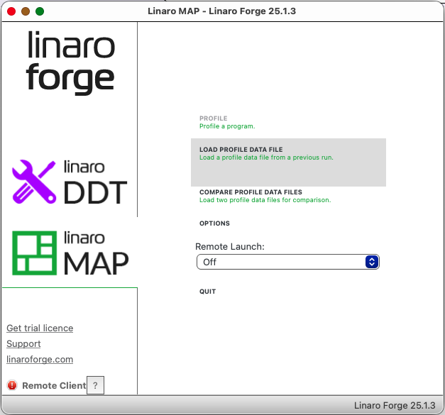
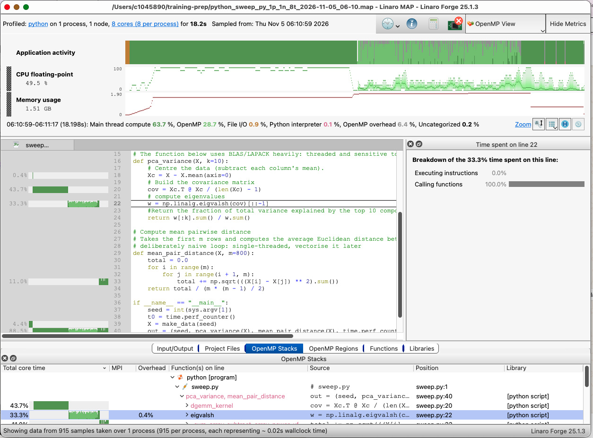

:::::::::::::::::::::::::::::::::::::: questions

- Where does my program spend its time?
- How do I profile a Python program with Linaro Forge on Falcon?
- What should I look at in the profile?

::::::::::::::::::::::::::::::::::::::::::::::::

::::::::::::::::::::::::::::::::::::: objectives

- Run a program under the Linaro Forge profiler (`map`) in a job script.
- Copy the profile to your computer and open it in the Linaro Forge client.
- Find the lines of code where most of the time goes.

::::::::::::::::::::::::::::::::::::::::::::::::

So far we have worked out *how much* of our script runs on one CPU from timings and from watching it. To improve the code we need
to know *where* the time goes, and guessing is notoriously unreliable. A **profiler** measures it, by looking at the program many
times a second and recording which line is running. On Falcon we use **Linaro Forge**, whose profiler is called **MAP**.

## Running the profiler

Load the module next to the Python one, and put `map --profile --no-mpi` in front of the command:

```bash
module load linaroforge/25.1.1
map --profile --no-mpi python sweep.py "${SEED}"
```

`--profile` runs the program without opening a window and writes the results to a file. That makes it suitable for a job script,
which is our job script from the "Protecting your data" episode with three changes:

```bash
#!/bin/bash --login
#SBATCH -J sweep-map
#SBATCH -o %x.o.%j
#SBATCH -e %x.e.%j
#SBATCH --ntasks=1
#SBATCH --cpus-per-task=8
#SBATCH --mem=4G
#SBATCH -A <project-code>
#SBATCH -t 00:10:00
#SBATCH -p <partition>

set -euo pipefail

module purge
module load SciPy-bundle/2023.07-gfbf-2023a
module load linaroforge/25.1.1

export OMP_NUM_THREADS=${SLURM_CPUS_PER_TASK}
SEED=${1:-42}

WORKDIR=/scratch/SCWFXXXXX/${USER}/sweep-map/${SLURM_JOB_ID}
mkdir -p "${WORKDIR}"
cp "${SLURM_SUBMIT_DIR}/sweep.py" "${WORKDIR}"
cd "${WORKDIR}"

# run the program under the profiler (--no-mpi: this is not an MPI program)
map --profile --no-mpi python sweep.py "${SEED}"

# copy back the result AND the profile
cp "result_${SEED}.csv" "${SLURM_SUBMIT_DIR}/result_${SEED}_${SLURM_JOB_ID}.csv"
cp ./*.map "${SLURM_SUBMIT_DIR}/"

cd "${SLURM_SUBMIT_DIR}"
rm -rf -- "${WORKDIR:?}"
```

:::::::::::::::::::::::::::::::::::::: callout

## Do not forget to copy the profile back

The profile is written to the directory the program runs in, which for us is the scratch directory that the script deletes at
the end. If the `.map` file is not copied back first, it is deleted with everything else.

The profiler sees only what runs under it, so loading it does not change your results, though it adds a small overhead to the run time.

::::::::::::::::::::::::::::::::::::::::::::::::

Submit it as usual with `sbatch sweep-map.sh 42`. At the end of the job, the output file contains a summary:

```output
Linaro Forge 25.1.1 - Linaro MAP

Profiling            : /shared/apps/easybuild/x86_64/amd/zen4/software/Python/3.11.3-GCCcore-12.3.0/bin/python sweep.py 42
Linaro Forge sampler : preload
MPI implementation   : Auto-Detect (None)
Python Version       : Auto-Detect (Python 3.11.3)

/shared/scratch/SCWF00004/c.myuser/sweep-map/860100/sweep.py:20: RuntimeWarning: invalid value encountered in matmul
  cov = Xc.T @ Xc / (len(Xc) - 1)

MAP analysing program...
Linaro Forge sampler: 0 libunwind: Unspecified (general) error (3/915 samples)
MAP gathering samples...
MAP generated /shared/scratch/SCWF00004/c.myuser/sweep-map/860100/python_sweep_py_1p_1n_8t_2026-11-05_06-10.map

Linaro MAP profiling summary
============================
Profiling time:      19 seconds
Peak process memory: 1895931904 B (~1.77 GiB)

Compute:              98.5%    (17.9s) |=========|
MPI:                   0.0%     (0.0s) |
I/O:                   0.9%     (0.2s) ||
Python Interpreter:    0.7%     (0.1s) ||
  (based on time on the main thread)
```

The file name tells you what was profiled: `1p_1n_8t` is one process on one node with 8 threads, followed by the date and time.

The summary is only a first impression:

- **Compute 98.5%** means the time was spent computing, not waiting for communication or files. It does not mean the computing was
  efficient.
- The **Python Interpreter** share is small because most of the time is spent inside compiled code (numpy) that Python calls,
  even for the slow loop.
- The **peak memory** was 1.77 GiB for this run, which is a useful figure for right-sizing.

The real information is in the `.map` file.

## Looking at the profile

The profile is viewed in the **Linaro Forge client**, which runs on your own computer.

1. [Install the client on your laptop][linaro-forge]. Use the version that matches Falcon's (25.1.1), or a newer one.
2. Copy the file from Falcon, with the SSH config entry from the first episode:

   ```bash
   scp falcon:'python_sweep_py_*.map' .
   ```

3. Start the client.
   - Select "linaro MAP" in the main menu
   - Click on "Load Profile Data File" and search for your *map file.

{alt="Linaro Forge Map main menu."}

{alt="Linaro Forge profiler view."}

The main views are:

- the **timeline** across the top, which shows what the program did over its run time, including how many CPUs were busy at each moment;
- the **source code**, where each line of your program has a bar showing the share of the run time spent on it; by default Linaro will try to access the source code with the path recorded in the file, which points to location in Falcon not available locally in your laptop, to fix it, search for a local copy of the source file.
- a list of **functions** ordered by total core time utilisation.

Start with the source code: the lines with the longest bars are the **hotspots**. They are where an
improvement pays off, and the lines with no bar at all are not worth your effort.
You can find more information about Linaro profiler including its view modes in their
[documentation website](https://docs.linaroforge.com/26.0.3/html/forge/map/main_thread_openmp_and_pthread_view_modes/index.html)


:::::::::::::::::::::::::::::::::::::: challenge

## Challenge: find the hotspot

Open the profile of the sweep script.

1. Which line of `sweep.py` takes the largest share of the run time? What share?
2. Which lines are next?
3. Look at the timeline. When are many CPUs busy, and when only one? Does it match what we saw in `htop`?
4. Is the biggest hotspot where you expected it to be?

::::::::::::::::::::::::::::::::::::: solution

The answer is in your own profile, so look at it rather than assuming. The candidates are the line in `mean_pair_distance` that
computes the distances inside the double loop, and the linear algebra lines of `pca_variance` (the matrix product and `eigvalsh`).
The timeline should show many busy CPUs for the part of the run in `pca_variance` and one for the rest, as in `htop`.

If the hotspot is not where you expected, that is the point of profiling: you now know which line to work on.

:::::::::::::::::::::::::::::::::::::

::::::::::::::::::::::::::::::::::::::::::::::::

<!--
:::::::::::::::::::::::::::::::::::::: callout

## The thread affinity messages

At the end of the summary you may see messages saying that thread bindings are not set, that threads have overlapping affinity
masks, or that a thread spans several L3 caches. Under Slurm, each thread may use any of the job's CPUs, so the first two are
normal. The third means threads could move between groups of cores that do not share a cache. These matter for programs whose
threads share data intensively. For our script, work on the biggest hotspot first and come back to placement only if the profile
points to it.

::::::::::::::::::::::::::::::::::::::::::::::::
-->
:::::::::::::::::::::::::::::::::::::::: keypoints

- A profiler measures where a program spends its time, so you can improve the code that matters.
- `map --profile` runs a program under MAP in a job script and writes a `.map` file.
- Copy the `.map` file out of the scratch directory before the script cleans it up, and open it in the Linaro Forge client on your computer.
- The source view shows the hotspots: the lines with the largest share of the time.
- The summary percentages are a first impression. The source and timeline views have the detail.

::::::::::::::::::::::::::::::::::::::::::::::::

:::::::::::::::::::::::::::::::::::::: instructor

## Instructor notes

**Timing.** About 15 minutes plus 10 for the exercise. Have the `.map` file ready for everyone in a shared location in case a
learner cannot install the client, or the licence or version gets in the way. Show the client on the projector.

**The profile can change the story.** Earlier episodes assumed that the long serial part of `sweep.py` is the pair-distance loop.
That was inferred from the shape of the scaling curve and not measured. Look at the profile before the session, and if the time
is split differently (for example if part of the serial time is in the eigenvalue calculation, which many linear algebra
libraries do not parallelise well), update the earlier wording and the challenge solution above.

**Check before the session.**

- Run the job on the node type learners will use, and replace the summary and file name.
- Check that `--no-mpi` is accepted by the installed version, and what the summary looks like without it.
- Check the licence for the profiler on the compute nodes, and for the client on learners' computers.
- Make sure the `.map` file is copied out and not deleted by the cleanup.

**The matmul warning.** Under MAP we saw `RuntimeWarning: invalid value encountered in matmul` for the covariance line, which we
have not explained. Run the same job without `map` and check whether the warning is still there, and whether the results agree.
Decide what to say if learners see it.

**Common problems.**

- Forgetting to load the profiler module, so `map: command not found`.
- No `.map` file after the job, because the scratch directory was cleaned up.
- A client older than the profiler cannot open the file.
- The name of the file, with its date and time, makes it harder to find when many are in one directory.
- Opening the profile on the cluster over X forwarding, which is slow. Use the client on your own computer.

::::::::::::::::::::::::::::::::::::::::::::::::
