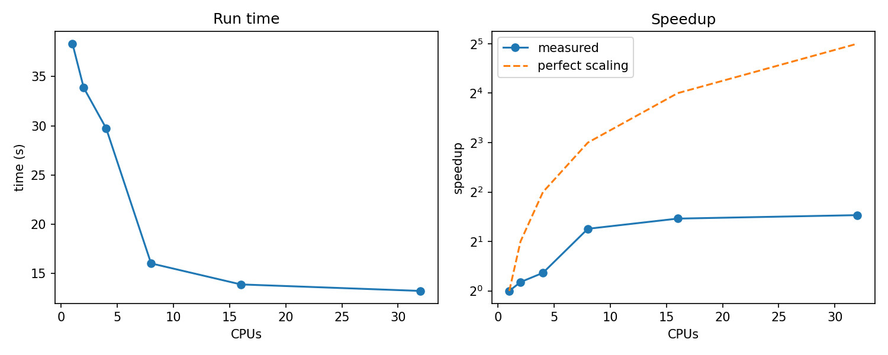

:::::::::::::::::::::::::::::::::::::: questions

- If I ask for more CPUs, will my job run faster?
- How do I measure how well a program uses extra CPUs?
- What limits how much faster a program can get?

::::::::::::::::::::::::::::::::::::::::::::::::

::::::::::::::::::::::::::::::::::::: objectives

- Run the same job with different numbers of CPUs and collect the timings.
- Plot run time and speedup against the number of CPUs.
- Calculate speedup and efficiency, and explain what they tell you.
- Explain Amdahl's law and use it to estimate the limit for a program.
- Choose a sensible number of CPUs to request.

::::::::::::::::::::::::::::::::::::::::::::::::

In the first job, Falcon was no faster than our researcher's laptop. She asked for 8 CPUs, so the obvious next thought is:
*what if I ask for 16, or 64, or a whole node?* Instead of guessing, we measure.

## Some vocabulary

Let `T(N)` be the run time of the same job on `N` CPUs. Two numbers describe how well the extra CPUs are used:

```
speedup(N)    = T(1) / T(N)         how many times faster than one CPU
efficiency(N) = speedup(N) / N      the share of the extra CPUs that is really used
```

With perfect scaling, 8 CPUs give a speedup of 8 and an efficiency of 100%. That almost never happens.

Measuring how a fixed problem speeds up as CPUs are added is called a **strong scaling** test. It is one of the most useful
things you can do before running anything big.

## Step 1: make the script label its results

We will submit the same job with different CPU counts, so each result file must say how many CPUs produced it. In the job
script from the last episode, change the line that copies the result back:

```bash
cp "result_${SEED}.csv" "${SLURM_SUBMIT_DIR}/result_${SEED}_c${SLURM_CPUS_PER_TASK}_${SLURM_JOB_ID}.csv"
```

Result files are now named like `result_42_c8_853301.csv`. Our script already sets
`OMP_NUM_THREADS=${SLURM_CPUS_PER_TASK}`, so numpy uses exactly the CPUs we ask for. That is why we can vary the request
without editing the script.

:::::::::::::::::::::::::::::::::::::: callout

## Use `-c`, not `-n`

We are changing **CPUs per task** (`-c`, or `--cpus-per-task`), because our script is one process with several threads.
`-n` changes the number of *tasks*, which would not make *this script* use more CPUs. Options given on the `sbatch` command
line override the `#SBATCH` lines in the script.

::::::::::::::::::::::::::::::::::::::::::::::::

## Step 2: submit the same job with different CPU counts

```bash
for N in 1 2 4 8 16 32; do
    sbatch -c ${N} -J sweep-c${N} run_scaling.sh 42
done
```

```output
Submitted batch job 853310
Submitted batch job 853311
Submitted batch job 853312
Submitted batch job 853313
Submitted batch job 853314
Submitted batch job 853315
```

`-J` gives each job a name that includes the CPU count, which makes the queue and the log files easy to read. Follow the
jobs with `squeue -u $USER`. They are independent, so they may run at the same time or in any order. While you wait, carry
on reading.

:::::::::::::::::::::::::::::::::::::: callout

## Be considerate, and repeat your runs

- The training partition is shared by the whole class. Stop at 32 CPUs in this exercise. We will show larger counts from
  earlier measurements.
- Other jobs on the same node can disturb a timing. If a result looks odd, run it again. For anything you plan to report,
  run each setting three times and use the average (or the shortest time).

::::::::::::::::::::::::::::::::::::::::::::::::

## Step 3: collect the timings

The script writes its own measured time into the last column of each result file. Collect the CPU count (from the file
name) and the time into one table. This uses the curly-bracket habit from the previous episode:

```bash
for f in result_42_c*.csv; do
    cpus=${f#result_42_c}          # remove the leading "result_42_c"
    cpus=${cpus%%_*}               # remove everything from the next underscore
    secs=$(cut -d, -f4 "${f}")     # the 4th column is the time in seconds
    echo "${cpus},${secs}"
done | sort -n > timings.csv
```

```bash
cat timings.csv
```

```output
1,38.3204
2,33.8575
4,29.7396
8,13.9871
8,13.9994
8,20.1247
16,13.7595
16,14.0474
32,13.2441
...
```

{alt="Plot showing the recorded timings using different number of CPUs"}


You can cross-check against what Slurm measured for the whole job, which also includes loading the module and starting Python:

```bash
sacct -X -S today --format=JobName,NCPUS,Elapsed,State
```

## Step 4: plot it

Bring `timings.csv` to your laptop with `scp` (your SSH keys make this painless), or paste the numbers into a spreadsheet.
This small script needs only numpy and matplotlib:

```python
# plot_scaling.py
import numpy as np
import matplotlib.pyplot as plt

data = np.loadtxt("timings.csv", delimiter=",")       # columns: CPUs, seconds
cpus, secs = data[:, 0], data[:, 1]

# average the repeated runs for each CPU count
n = np.unique(cpus)
t = np.array([secs[cpus == c].mean() for c in n])
speedup = t[n == 1][0] / t

fig, (ax1, ax2) = plt.subplots(1, 2, figsize=(10, 4))

ax1.plot(n, t, "o-")
ax1.set_xlabel("CPUs")
ax1.set_ylabel("time (s)")
ax1.set_title("Run time")

ax2.plot(n, speedup, "o-", label="measured")
ax2.plot(n, n, "--", label="perfect scaling")
ax2.set_yscale("log", base=2)
ax2.set_xlabel("CPUs")
ax2.set_ylabel("speedup")
ax2.set_title("Speedup")
ax2.legend()

fig.tight_layout()
fig.savefig("scaling.png", dpi=150)
plt.show()
```

## What the measurements show

These are measurements from the instructor's runs on Falcon. Yours will differ in detail but should look similar. The
columns are calculated from the times, with repeated runs averaged:

| CPUs | Time (s) | Speedup | Efficiency | CPU-seconds used |
|----: |---------:|--------:|-----------:|-----------------:|
| 1    | 21.88    | 1.00    | 100%       | 22     |
| 2    | 18.94    | 1.16    | 58%        | 38     |
| 4    | 18.10    | 1.21    | 30%        | 72     |
| 8    | 16.39    | 1.34    | 17%        | 131    |
| 16   | 15.92    | 1.37    | 9%         | 255    |
| 32   | 13.09    | 1.67    | 5%         | 419    |
| 64   | 13.49    | 1.62    | 3%         | 863    |
| 128  | 95.43    | 0.23    | 0.2%       | 12,215 |

*CPU-seconds* is the number of CPUs multiplied by the run time. It is roughly what the job costs you in usage and in
resources that nobody else can use while it runs.

Three things stand out:

1. **The speedup is small.** 32 times as many CPUs gives about 1.7 times the speed.
2. **The curve flattens.** There is no "sweet spot" at 32. The curve is hitting a floor of about 13 seconds, and the extra
   CPUs beyond a few are doing almost nothing.
3. **At 128 CPUs the job became about seven times slower than a single CPU.** Asking for more resources made things
   *worse*, and used about 560 times as many CPU-seconds as the single-CPU run.

:::::::::::::::::::::::::::::::::::::: challenge

## Challenge: speedup and efficiency

Using the table above, or your own results:

1. Calculate the speedup and efficiency for 8 and for 32 CPUs from the times.
2. Which CPU count gives the best efficiency? Which gives the shortest run time?
3. Are these the same? What does that tell you about choosing a number of CPUs?

::::::::::::::::::::::::::::::::::::: solution

1. For 8 CPUs, the speedup is 21.88 / 16.39 = 1.34 and the efficiency is 1.34 / 8 = 17%. For 32 CPUs, the speedup is
   21.88 / 13.09 = 1.67 and the efficiency is 1.67 / 32 = 5%.
2. The best efficiency is at 1 CPU (100%). The shortest time is at 32 or 64 CPUs, depending on the run.
3. They are different, and that is the normal situation: the fastest setting is rarely the efficient one. You have to
   decide how much extra speed is worth the extra resources. Here, going from 8 to 32 CPUs saves about 3 seconds but costs
   three times as many CPU-seconds.
4. Remember to factor in the additional queue time from larger resource requests.

:::::::::::::::::::::::::::::::::::::

::::::::::::::::::::::::::::::::::::::::::::::::

## Why? Amdahl's law

Our script has two stages:

1. A principal component analysis, built on linear algebra routines that **can** use several CPUs.
2. A plain Python loop that computes distances between pairs of rows, which runs on **one** CPU however many we request.

Extra CPUs only speed up the first stage:

```
1 CPU :  [ serial part ================ ][ parallel part ========== ]
8 CPUs:  [ serial part ================ ][ par ]
                                           ^ only this part shrinks
```

This is **Amdahl's law**. If a fraction `p` of the run time can be spread across CPUs and the rest, `1 - p`, cannot, the
best possible speedup on `N` CPUs is:

```
speedup(N) = 1 / ( (1 - p) + p / N )
```

As `N` grows, the `p / N` term vanishes, and the speedup can never exceed `1 / (1 - p)`, however many CPUs you add.

| Parallel fraction `p` | N = 2 | N = 8 | N = 32 | N = 128 | Limit |
|---:|---:|---:|---:|---:|---:|
| 50% | 1.3 | 1.8 | 1.9 | 2.0 | 2 |
| 90% | 1.8 | 4.7 | 7.8 | 9.3 | 10 |
| 99% | 2.0 | 7.5 | 24 | 56 | 100 |

Even a program that is 90% parallel can never be more than 10 times faster, and the last 10% of its run time dominates
once you use many CPUs.

For our script, the run time stops falling at about 13 seconds out of 22. So roughly 60% of the time is serial, the
parallel fraction `p` is about 0.4, and the limit is about `1 / 0.6`, or 1.6 times faster than one CPU. That matches the
measurements. (This is an estimate from the curve. In a later episode we use a profiler to see the serial part directly.)

:::::::::::::::::::::::::::::::::::::: challenge

## Challenge: using Amdahl's law

A program spends 10% of its run time in a part that cannot be parallelised.

1. What is the best speedup on 16 CPUs?
2. And on 128 CPUs?
3. What is the limit, however many CPUs you use?

::::::::::::::::::::::::::::::::::::: solution

Here `p = 0.9`.

1. `1 / (0.1 + 0.9/16)` = 6.4
2. `1 / (0.1 + 0.9/128)` = 9.3
3. `1 / 0.1` = 10

Going from 16 to 128 CPUs (eight times the resources) gains less than 50% in speed.

:::::::::::::::::::::::::::::::::::::

::::::::::::::::::::::::::::::::::::::::::::::::

<!--
## What happened at 128 CPUs?

Amdahl's law explains the flat curve, but it never predicts a program getting *slower* when it gets more CPUs. The jump at
128 is something else, and the data alone does not tell us what. Plausible causes include:

- **A different kind of node.** A request for 128 CPUs can only run on nodes with at least that many cores, which may not
  be the nodes the smaller jobs used.
- **No spare CPU for the system.** Threads in a linear algebra routine wait for each other many times. If the operating
  system needs one of *your* CPUs for a moment, all the other threads wait for it. With a whole node allocated there is
  nowhere else for the system to run.
- **Spreading across the processor.** A big node contains several processor chips and groups of cores. Threads that must
  constantly share data run slower when they sit far apart.
- **A one-off.** We ran 128 only once. Always repeat a surprising result before building a theory on it.

We will not settle this here. In the next episodes we look at what the jobs *actually* did (`sacct`, `seff`, `htop`) and
at a profiler. For now the lesson is practical: **asking for more is not harmless, and the only way to know is to
measure.**
-->

:::::::::::::::::::::::::::::::::::::: challenge

## Challenge: how many CPUs would you ask for?

Based on the results, how many CPUs would you request for this script? Argue your case with the numbers, considering time,
efficiency and cost. Is there a single right answer?

::::::::::::::::::::::::::::::::::::: solution

There is no single right answer, but every sensible answer is small. A few CPUs (1 to 4) already give nearly all the
speedup this script can ever have, and more than 8 gains almost nothing while costing much more. Smaller requests also tend
to start sooner, and leave the other CPUs of the node for other users.

The bigger lesson is that more CPUs are not the way to speed this script up. Two better ways follow in this course: make
the serial part faster by improving the code, and run **many** copies of the script at the same time, which uses the
cluster the way it is meant to be used.

:::::::::::::::::::::::::::::::::::::

::::::::::::::::::::::::::::::::::::::::::::::::

:::::::::::::::::::::::::::::::::::::: callout

## A supercomputer is many computers, not a faster computer

Our researcher does not need one run to finish sooner. She needs hundreds of runs, each with a different seed. Hundreds of
independent single-CPU runs have no serial bottleneck at all: every CPU you add really does give more results per hour.
That is the idea behind array jobs and GNU Parallel, which come later in the course.

::::::::::::::::::::::::::::::::::::::::::::::::

:::::::::::::::::::::::::::::::::::::::: keypoints

- More CPUs do not automatically mean a faster job. Measure it with a scaling test before asking for many.
- Speedup is `T(1) / T(N)` and efficiency is speedup divided by the number of CPUs.
- Amdahl's law: the part of a program that cannot use extra CPUs limits the speedup to `1 / (1 - p)`.
- The fastest setting is rarely the most efficient. Choose a request that balances run time and cost.
- Asking for too much can make a job slower, and always makes it more expensive. Repeat surprising measurements.
- For many independent runs, run them side by side instead of making one run bigger.

::::::::::::::::::::::::::::::::::::::::::::::::

:::::::::::::::::::::::::::::::::::::: instructor

## Instructor notes

**Timing.** About 25 minutes plus 15 of exercises. Submit the scaling jobs at the start of the episode, then explain the
vocabulary and Amdahl's law while they run, and come back to collect and plot the results.

**Capacity.** If the whole class submits 64 or 128 CPU jobs at once, the training partition will fill up. The text limits
learners to 32. Show the larger counts from your own measurements.

**Investigate the 128-CPU result before the session.** The text deliberately lists possible causes rather than naming
one, because the data does not settle it. Before teaching, it is worth running these:

- Repeat 128 three times. Is it reproducible?
- Record the node: `sacct -j <jobid> -o JobID,NodeList,Elapsed`, and compare `lscpu` (model, sockets, threads per core)
  between the 64 and 128 CPU jobs.
- Try 96, 112 and 127 CPUs. If 96 is fine and larger counts are slow, a processor boundary is likely. If 127 recovers, the
  cause is probably system activity on a fully allocated node.
- Try `-c 128` with `OMP_NUM_THREADS=64`, to separate "allocated 128" from "used 128 threads".
- Look at `seff` for the 128 CPU job. Threads that spin while waiting count as busy time, so the CPU efficiency may look
  high for a job that was very slow. This makes a good lead into the efficiency episode.

Once you know the cause, update the "What happened at 128 CPUs?" section to say so.

**Check before the session.**

- Confirm that `sbatch -c N` overrides the `#SBATCH` line on Falcon and that `SLURM_CPUS_PER_TASK` is set accordingly.
- Make sure learners can run the plot: either matplotlib on their laptop, or have them paste the numbers into a spreadsheet.
- Confirm the one-CPU run finishes comfortably inside the time limit (5 minutes in the script).

**Common problems.**

- Using `-n` instead of `-c`. The jobs run, but nothing changes.
- Forgetting to change the result file name, so results overwrite each other or cannot be told apart.
- Mixing up the script's own time with Slurm's `Elapsed`. Both are useful, but they differ by the start-up cost.
- Reading the flattening curve as a "sweet spot".
- Windows line endings in the loop commands pasted from a document.

::::::::::::::::::::::::::::::::::::::::::::::::
